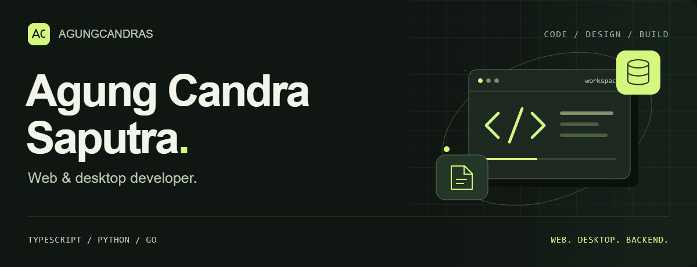
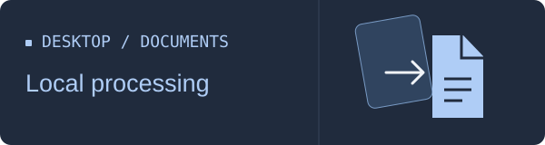
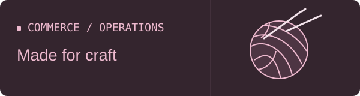

<picture>
  <source media="(prefers-reduced-motion: reduce)" srcset="./assets/profile-banner.svg">
  
</picture>

  <a href="#proyek-pilihan">Proyek pilihan</a> &nbsp; / &nbsp;
  <a href="#teknologi">Teknologi</a> &nbsp; / &nbsp;
  <a href="https://github.com/AgungCandraS?tab=repositories">Repository</a>

## Halo, saya Agung.

Saya membangun aplikasi web dan desktop, dari booking wisata sampai pengolahan dokumen. Saya mengerjakan antarmuka, backend, dan alur data di baliknya.

## Proyek pilihan

<table>
<tr>
<td width="50%" valign="top">

<h3><a href="https://github.com/AgungCandraS/tripora">01 / Tripora</a></h3>

Marketplace wisata Bandung Raya. Booking, pembayaran, dan e-ticket QR dalam satu alur.

<code>Next.js</code> <code>NestJS</code> <code>PostgreSQL</code>

</td>
<td width="50%" valign="top">

<h3><a href="https://github.com/AgungCandraS/DokuConvert">02 / DocuConvert</a></h3>

Aplikasi desktop untuk konversi dokumen dan pengolahan PDF. File diproses secara lokal.

<code>Python</code> <code>PySide6</code>

</td>
</tr>
<tr>
<td width="50%" valign="top">

<h3><a href="https://github.com/AgungCandraS/bengkel-haris">03 / Bengkel Harris</a></h3>

Website layanan bengkel dengan informasi servis dan pengajuan jadwal melalui WhatsApp.

<code>Astro</code> <code>TypeScript</code>

<a href="https://agungcandras.github.io/bengkel-haris/">Lihat website ↗</a>

</td>
<td width="50%" valign="top">

<h3><a href="https://github.com/AgungCandraS/saputra-rajoet">04 / Saputra Rajut</a></h3>

E-commerce produk rajut dengan pengelolaan pesanan, inventori, pembayaran, dan pengiriman.

<code>Nuxt</code> <code>Go</code> <code>PostgreSQL</code>

</td>
</tr>
</table>

## Teknologi

| Area | Yang saya gunakan |
| :--- | :--- |
| Bahasa | TypeScript · JavaScript · Python · Go |
| Frontend | Next.js · Nuxt · Astro |
| Backend & data | NestJS · PostgreSQL · Redis |
| Desktop | PySide6 |

---

Lihat kode, dokumentasi, dan eksperimen lainnya di [repository saya ↗](https://github.com/AgungCandraS?tab=repositories).
