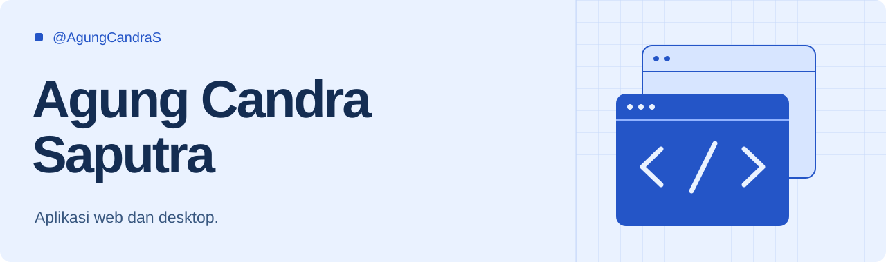

### Halo, saya Agung.

Saya membangun aplikasi web dan desktop, dari platform booking wisata sampai alat untuk mengelola dokumen. Di sini saya menyimpan proyek, eksperimen, dan hasil belajar saya.

### Proyek pilihan

| Proyek | Yang saya bangun | Teknologi |
| :--- | :--- | :--- |
| [Tripora](https://github.com/AgungCandraS/tripora) | Marketplace wisata Bandung Raya dengan booking, pembayaran, dan e-ticket QR. | Next.js, NestJS, PostgreSQL |
| [DocuConvert](https://github.com/AgungCandraS/DokuConvert) | Aplikasi desktop untuk konversi dokumen dan pengolahan PDF secara lokal. | Python, PySide6 |
| [Bengkel Harris](https://github.com/AgungCandraS/bengkel-haris) | Website layanan bengkel dengan pengajuan jadwal melalui WhatsApp. | Astro, TypeScript |
| [Saputra Rajut](https://github.com/AgungCandraS/saputra-rajoet) | E-commerce dan pengelolaan pesanan untuk produk rajut. | Nuxt, Go, PostgreSQL |

### Teknologi yang saya gunakan

**Bahasa** &nbsp; `TypeScript` · `JavaScript` · `Python` · `Go`

**Web & desktop** &nbsp; `Next.js` · `NestJS` · `Nuxt` · `Astro` · `PySide6`

**Data** &nbsp; `PostgreSQL` · `Redis`

[Lihat semua repository](https://github.com/AgungCandraS?tab=repositories)
